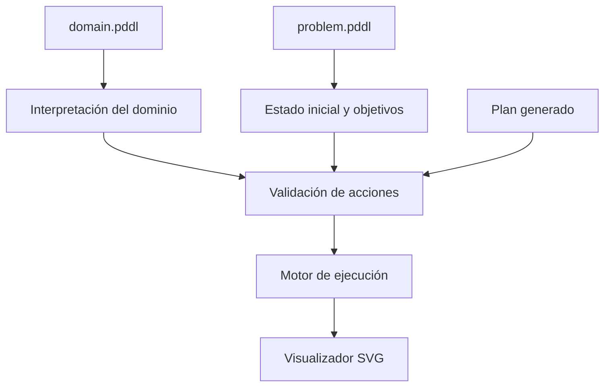

<p align="center">
  
</p>

<p align="center">
  
  
  
  
</p>

<p align="center">
  <a href="https://isaiassolis.github.io/automatic-planning-pddl-rover/visualizer/"></a>
  <a href="https://github.com/isaiassolis"></a>
</p>

# Planificación automática con PDDL — Rover e IPC 2018

**Inteligencia artificial simbólica · Modelado de acciones y restricciones · Desarrollo de visualizador interactivo**

Desarrollé este proyecto para explorar la **planificación automática**, una rama de la inteligencia artificial que permite encontrar secuencias de acciones capaces de transformar un estado inicial en un estado objetivo.

Trabajé con **PDDL (Planning Domain Definition Language)** y planificadores de la **International Planning Competition 2018**. Además de experimentar con problemas de referencia, diseñé un **dominio Rover** para el transporte de minerales y construí un **visualizador web en JavaScript y SVG** que permite ejecutar y comprobar planes paso a paso.

### [Explorar la demostración interactiva de Rover](https://isaiassolis.github.io/automatic-planning-pddl-rover/visualizer/)


## El problema que quise resolver

Un sistema autónomo necesita tomar decisiones respetando las condiciones de su entorno. No basta con definir un destino: hay que considerar qué acciones son posibles, qué recursos están disponibles y qué condiciones deben cumplirse antes de actuar.

Con PDDL podemos representar **estados, acciones, precondiciones, efectos y objetivos**. Los planificadores utilizan ese modelo para buscar una secuencia válida de operaciones.

Mi objetivo fue **conectar el razonamiento simbólico con una experiencia visual**, de modo que pudiera observarse cómo se ejecuta cada acción y por qué una operación es válida o inválida.

## El dominio Rover

Diseñé un escenario donde un rover autónomo debe **recoger minerales y entregarlos a laboratorios** mediante una red de ubicaciones conectadas.

El dominio permite:

- Desplazarse por rutas dirigidas o bidireccionales.
- Recoger un mineral cuando el rover se encuentra en su ubicación.
- Transportar **un mineral a la vez**.
- Entregar materiales únicamente en laboratorios compatibles.
- Comprobar que todos los minerales requeridos se entregaron.

### Predicados principales

| Predicado | Significado |
| --- | --- |
| `at` | Ubicación actual del rover |
| `rock-at` | Posición de un mineral |
| `connected` | Conexión permitida entre localidades |
| `carrying` | Mineral que transporta el rover |
| `empty` | Rover disponible para recoger material |
| `lab` | Localidad con laboratorio |
| `accepts` | Compatibilidad entre laboratorio y mineral |
| `delivered` | Mineral entregado |

Las acciones principales de mi dominio son **`move`**, **`pickup`** y **`drop`**. Sus precondiciones y efectos determinan cómo cambia el estado después de cada operación.

[Consultar el dominio PDDL](rover/domain.pddl).

## Tres escenarios de planificación

Construí tres problemas que reutilizan el mismo archivo `domain.pddl` y aumentan progresivamente las restricciones del entorno.

### Escenario 1 — Transporte básico


El rover comienza en **L4**, debe recoger dos minerales en distintas ubicaciones y entregarlos al laboratorio **L5**. Introduce movimiento, recolección y rutas con direcciones específicas.

### Escenario 2 — Entorno ampliado


Agregué un mineral, más ubicaciones y nuevas rutas, aumentando el espacio de búsqueda y la longitud del plan.

### Escenario 3 — Laboratorios especializados


Incorporé dos laboratorios que reciben únicamente determinados minerales. El plan debe respetar no solo las rutas y la capacidad de carga, sino también la **compatibilidad de las entregas**.

## Visualizador interactivo

Además del modelado PDDL, desarrollé una aplicación web que permite **observar, ejecutar y validar planes** sin depender de una interfaz de línea de comandos.


El visualizador incorpora:

- Representación gráfica con **SVG**.
- Carga de escenarios y planes.
- Procesamiento de archivos PDDL del dominio Rover.
- Ejecución manual y reproducción automática.
- Animación del rover y seguimiento de minerales.
- Identificación de la acción en ejecución.
- Comprobación de rutas, estados y condiciones de transporte.
- Detección de acciones inválidas y mensajes explicativos.

### Cómo se procesa un plan



Por ejemplo, si un plan intenta desplazarse entre ubicaciones que no están conectadas, el sistema detiene la ejecución y muestra un mensaje como:

```text
Invalid move: no connection from L5 to L6
```

El parser y el validador implementados están enfocados en el **dominio Rover**.

**[Abrir el visualizador en GitHub Pages](https://isaiassolis.github.io/automatic-planning-pddl-rover/visualizer/)**

## Experimentos con planificadores IPC 2018

Trabajé con **Delfi1** y **Complementary2**, utilizando contenedores **Singularity** para ejecutar problemas de planificación clásicos, incluido el dominio de referencia **Snake**.

### Resultados de Rover

| Escenario | Acciones del plan | Costo | Tiempo registrado |
| --- | ---: | ---: | ---: |
| Problema 1 | 14 | 14 | 0.06 s |
| Problema 2 | 21 | 21 | 0.08 s |
| Problema 3 | 27 | 27 | 0.0026 s |

Los tres escenarios cuentan con planes válidos. La complejidad del entorno y las restricciones se reflejan en planes de mayor longitud; el tiempo depende también del problema y de las condiciones de ejecución, por lo que no tiene por qué aumentar de manera lineal.

### Comparación de planificadores con Snake

| Métrica | Complementary2 | Delfi1 |
| --- | ---: | ---: |
| Costo del plan | 24 | 24 |
| Longitud del plan | 24 | 24 |
| Estados evaluados | 267,789 | 87 |
| Estados generados | 337,799 | 86 |
| Tiempo de búsqueda | 1.69 s | 0.39 s |

Ambos generaron soluciones de **costo 24**. En esta ejecución, **Delfi1** exploró menos estados y completó la búsqueda en menos tiempo.

## Tecnologías y herramientas

| Área | Tecnología |
| --- | --- |
| Modelado simbólico | **PDDL / STRIPS** |
| Planificadores | **Delfi1 y Complementary2 (IPC 2018)** |
| Entorno de ejecución | **Linux y Singularity / SingularityCE** |
| Aplicación interactiva | **HTML, CSS y JavaScript** |
| Representación gráfica | **SVG** |
| Publicación de la demostración | **GitHub Pages** |

## Cómo ejecutar los planificadores

Los experimentos se realizaron en un entorno Linux basado en Ubuntu / Pop!_OS, utilizando contenedores Singularity.

Instalación en un entorno compatible:

```bash
sudo apt update
sudo apt install singularity-container -y
singularity --version
```

Para construir la imagen a partir de la receta `Singularity` del planificador:

```bash
sudo singularity build planner.img Singularity
```

Ejemplo de ejecución, ajustando las rutas y usando la imagen correspondiente al planificador:

```bash
RUNDIR="$(pwd)/rover_problem1"
DOMAIN="$RUNDIR/domain.pddl"
PROBLEM="$RUNDIR/problem1.pddl"
PLANFILE="$RUNDIR/sas_plan"

singularity run -C -H "$RUNDIR" planner.img "$DOMAIN" "$PROBLEM" "$PLANFILE"
```

La disponibilidad del paquete Singularity y de las imágenes IPC 2018 depende de la distribución y el entorno utilizados.

## Estructura principal

```text
automatic-planning-pddl-rover/
├── rover/
│   ├── domain.pddl
│   ├── problem1.pddl
│   ├── problem2.pddl
│   └── problem3.pddl
├── snake/
│   ├── domain.pddl
│   └── p01.pddl
├── plans/
│   ├── problem1_plan.txt
│   ├── problem2_plan.txt
│   └── problem3_plan.txt
├── screenshots/
└── visualizer/
    ├── index.html
    ├── style.css
    ├── app.js
    └── data/
```

## Mi participación y aprendizajes

En este proyecto trabajé en el **modelado del dominio y los problemas PDDL**, en la ejecución y comparación de planificadores, y en el **desarrollo del visualizador interactivo**.

Me permitió combinar la lógica de planificación con el diseño de una interfaz que hace visible el comportamiento del sistema: desde las precondiciones de una acción hasta la verificación de un objetivo.

La planificación simbólica resulta útil para estudiar problemas de **robótica, logística, sistemas autónomos y agentes inteligentes**, especialmente cuando las reglas y restricciones deben estar definidas de manera explícita.

## Evolución posible

Me interesa ampliar este trabajo hacia la explicación de acciones, el soporte de otros dominios, la ejecución integrada de planificadores y la generación asistida de modelos PDDL con LLM. Estas líneas forman parte de una posible evolución, no de la versión publicada.

## Licencia

El código publicado se distribuye bajo la [licencia MIT](LICENSE).

---

<p align="center"><strong>Modelar decisiones, generar planes y comprender su ejecución.</strong></p>
<p align="center"><a href="https://github.com/isaiassolis">Isaías Solís · Portafolio profesional</a></p>
