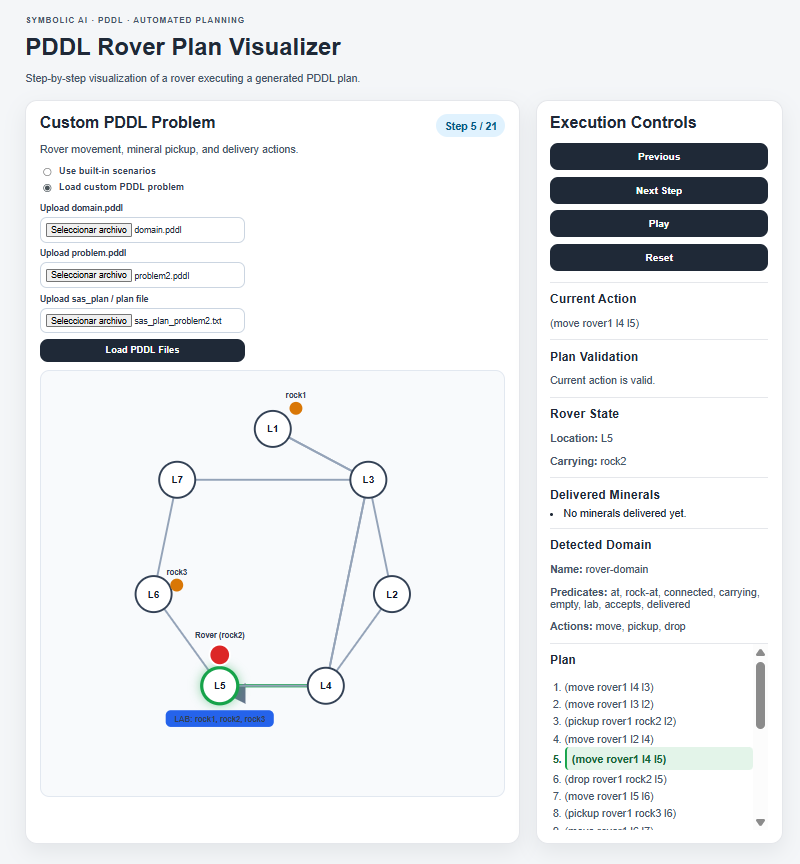
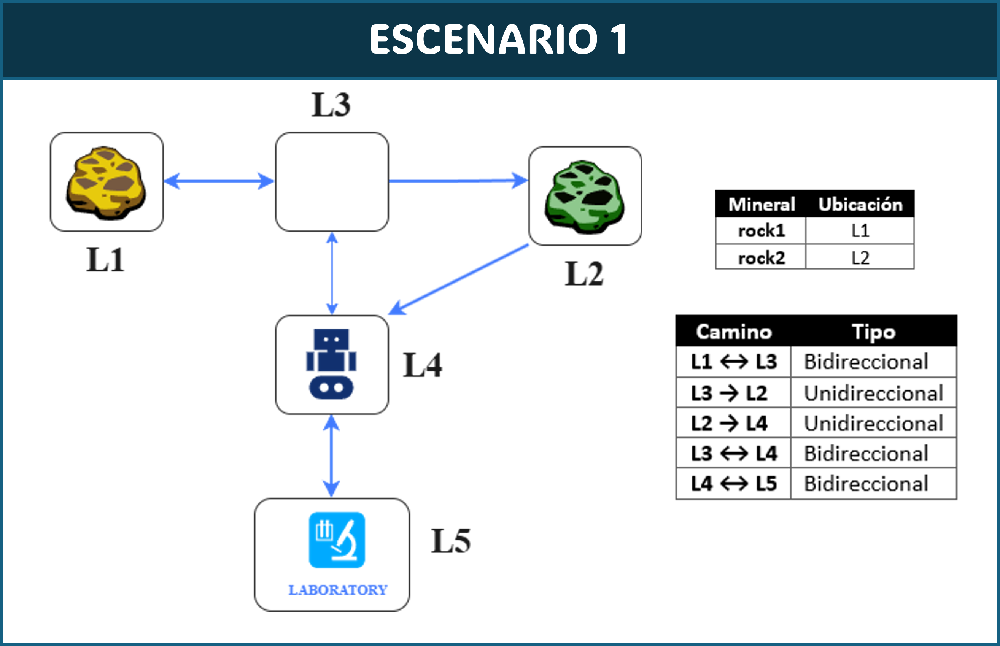
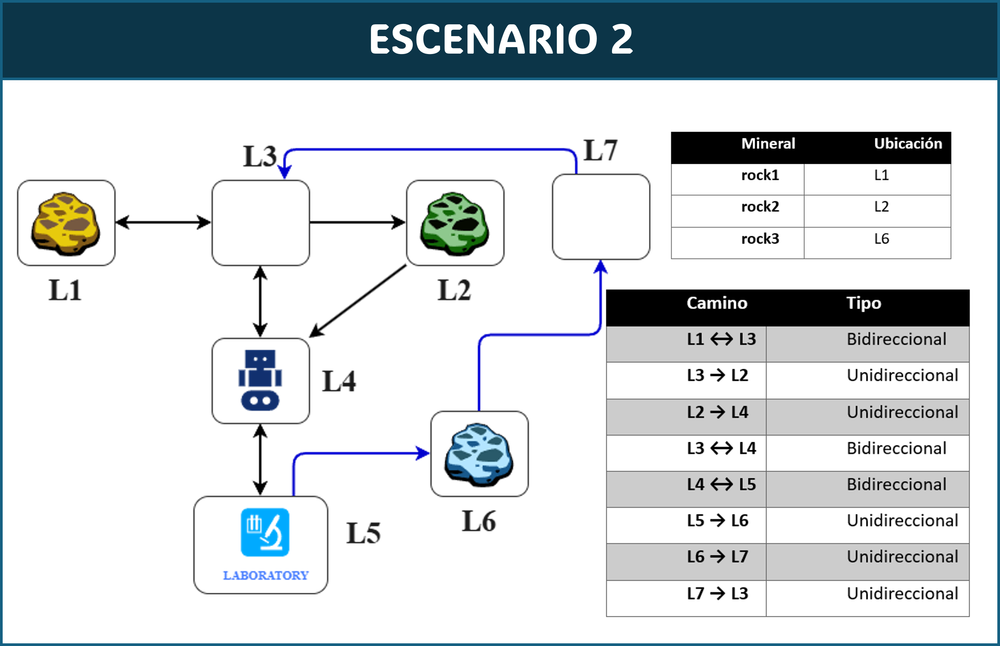
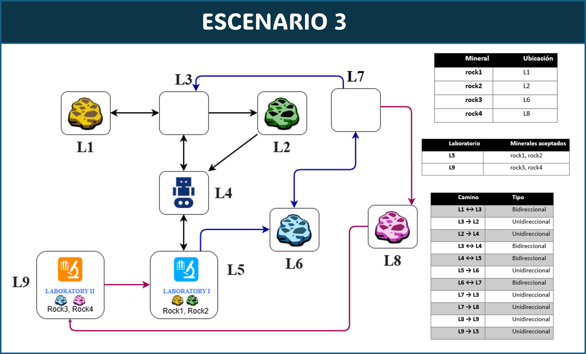

# Automatic Planning with PDDL and IPC 2018 Planners

This repository presents a reproducible hands-on project for learning and experimenting with **automated planning**, **PDDL**, and classical planners from the **International Planning Competition (IPC) 2018**.

The project includes the execution of IPC 2018 planners and the development of a custom **Rover transportation domain**, where an autonomous rover must collect minerals and deliver them to laboratories under different constraints.

The goal is to provide a practical, educational, and reproducible example of symbolic AI planning.


---

## Interactive Rover Visualizer

The repository also includes a web-based interactive visualizer capable of executing rover planning scenarios step-by-step.

### Visualizer Features

- Multiple planning scenarios
- Interactive scenario selection
- Step-by-step execution
- Automatic playback mode
- Rover state tracking
- Mineral pickup and delivery simulation
- Dynamic SVG graph rendering
- Laboratory compatibility visualization

### Visualizer Preview




## Project Overview

Automated planning is a field of symbolic artificial intelligence focused on generating sequences of actions that transform an initial state into a desired goal state.

In this project, planning problems are modeled using **PDDL (Planning Domain Definition Language)**. The experiments are executed using classical planners distributed through IPC 2018, mainly:

* **Delfi1**
* **Complementary2**

The project also includes a custom Rover domain designed to demonstrate how a single `domain.pddl` file can be reused across multiple planning scenarios.

---

## Main Features

* Reproducible execution using Singularity containers.
* Execution of IPC 2018 planners.
* Analysis of the Snake benchmark domain.
* Custom Rover domain developed in PDDL.
* Three progressively complex planning scenarios.
* Directed and bidirectional paths.
* Mineral transportation constraints.
* Specialized laboratories with compatibility rules.
* Planner performance comparison.

---

## Repository Structure

```text
automatic-planning-pddl-rover/
│
├── README.md
├── LICENSE
│
├── rover/
│   ├── domain.pddl
│   ├── problem1.pddl
│   ├── problem2.pddl
│   └── problem3.pddl
│
├── snake/
│   ├── domain.pddl
│   └── p01.pddl
│
├── plans/
│   ├── problem1_plan.txt
│   ├── problem2_plan.txt
│   └── problem3_plan.txt
│
├── screenshots/
│   ├── scenario1.png
│   ├── scenario2.png
│   └── scenario3.png
│   
├── visualizer/
│   ├── index.html
│   ├── style.css
│   ├── app.js
│   │
│   └── data/
│       ├── scenario1.json
│       ├── scenario2.json
│       ├── scenario3.json
│       ├── problem1_plan.txt
│       ├── problem2_plan.txt
│       └── problem3_plan.txt
 

```

---

## Requirements

This project was tested on a Linux environment using:

* Pop!_OS / Ubuntu-based Linux distribution
* Singularity / SingularityCE
* IPC 2018 planner containers
* PDDL domain and problem files

Install Singularity using:

```bash
sudo apt update
sudo apt install singularity-container -y
```

Check the installation:

```bash
singularity --version
```

---

## Building a Planner Container

From inside the planner directory, build the Singularity image using:

```bash
sudo singularity build planner.img Singularity
```

This generates a `planner.img` file containing the required planner environment.

---

## Running a Planner

Create a runtime directory and define the domain, problem, and output plan file:

```bash
RUNDIR="$(pwd)/rover_problem1"
DOMAIN="$RUNDIR/domain.pddl"
PROBLEM="$RUNDIR/problem1.pddl"
PLANFILE="$RUNDIR/sas_plan"
```

Then execute the planner:

```bash
singularity run -C -H $RUNDIR planner.img $DOMAIN $PROBLEM $PLANFILE
```

The generated plan will be saved in the output file defined by `PLANFILE`.

---

## Rover Domain

The custom Rover domain models a rover that must transport minerals from different locations to analysis laboratories.

### Predicates

| Predicate   | Description                                       |
| ----------- | ------------------------------------------------- |
| `at`        | Current position of the rover                     |
| `rock-at`   | Location of each mineral                          |
| `connected` | Valid path between locations                      |
| `carrying`  | Mineral currently carried by the rover            |
| `empty`     | Indicates that the rover is not carrying anything |
| `lab`       | Defines a laboratory location                     |
| `accepts`   | Defines laboratory-mineral compatibility          |
| `delivered` | Indicates that a mineral has been delivered       |

### Actions

The domain includes three main actions:

* `move`: moves the rover between connected locations.
* `pickup`: allows the rover to collect a mineral.
* `drop`: allows the rover to deliver a mineral to a compatible laboratory.

---

## Planning Scenarios

### Scenario 1: Basic Mineral Transportation



The rover starts at location `L4` and must collect two minerals located at different locations. Both minerals must be delivered to laboratory `L5`.

This scenario introduces:

* basic movement,
* mineral pickup,
* mineral delivery,
* directed and bidirectional paths.

### Scenario 2: Expanded Environment



The second scenario adds a new mineral and additional locations, increasing the complexity of the search space.

This scenario introduces:

* more minerals,
* additional routes,
* longer plans,
* expanded navigation constraints.

### Scenario 3: Specialized Laboratories



The third scenario introduces two specialized laboratories. Each laboratory accepts only specific minerals.

This scenario introduces:

* multiple laboratories,
* mineral-laboratory compatibility,
* additional locations,
* more complex delivery constraints.

---

## Web-Based Planning Visualization

A lightweight frontend visualizer was developed using:

- HTML
- CSS
- JavaScript
- SVG rendering

The visualizer dynamically loads planning scenarios and generated plans, allowing interactive exploration of automated planning behavior.

Users can:
- execute plans manually,
- autoplay planning sequences,
- inspect rover states,
- track delivered minerals,
- and compare progressively complex planning environments.

---

## Live Demo

https://darksite79.github.io/automatic-planning-pddl-rover/visualizer/

---

## Experimental Results

| Scenario  | Plan Length | Plan Cost | Total Time |
| --------- | ----------: | --------: | ---------: |
| Problem 1 |          14 |        14 |      0.06s |
| Problem 2 |          21 |        21 |      0.08s |
| Problem 3 |          27 |        27 |    0.0026s |

The results show that increasing the complexity of the environment produces longer plans, as expected in automated planning problems. However, the planner was able to generate valid solutions for all scenarios.

---

## Planner Comparison

The Snake benchmark was used to compare two IPC 2018 planners: Delfi1 and Complementary2.

| Metric           | Complementary2 | Delfi1 |
| ---------------- | -------------: | -----: |
| Plan cost        |             24 |     24 |
| Plan length      |             24 |     24 |
| Evaluated states |        267,789 |     87 |
| Generated states |        337,799 |     86 |
| Search time      |          1.69s |  0.39s |

Both planners found optimal solutions. However, Delfi1 showed a more efficient performance in terms of evaluated states and search time.

---

## Why This Project Matters

This project demonstrates how symbolic AI can be used to model and solve structured decision-making problems. Unlike purely data-driven machine learning projects, automated planning focuses on explicit representations of actions, states, constraints, and goals.

This makes PDDL-based planning especially relevant for:

* robotics,
* logistics,
* autonomous systems,
* task planning,
* intelligent agents,
* hybrid AI systems.

---

## Future Work

Possible extensions of this project include:

* adding more IPC planners,
* comparing modern planners,
* creating automated benchmark scripts,
* visualizing generated plans,
* building a web-based planning visualizer,
* integrating LLMs to generate PDDL from natural language descriptions.

---

## License

This project is intended for educational and research purposes.

A permissive license such as MIT can be added if the repository is intended to be publicly shared.
